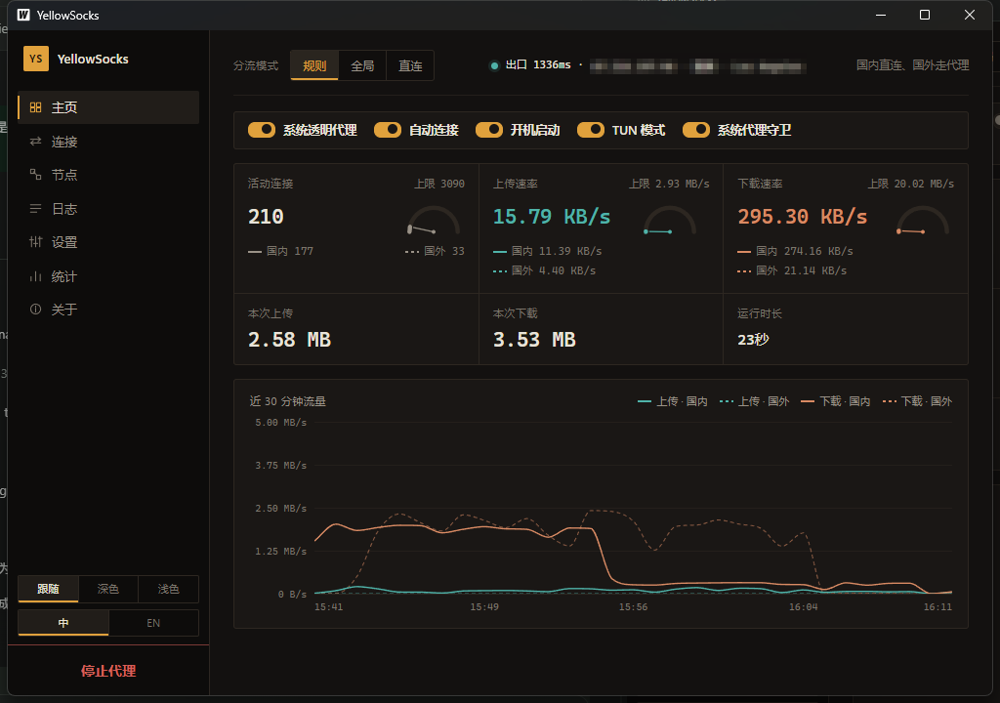

# yellowsocks

**English** | [简体中文](README.zh-CN.md)

[](https://github.com/esrrhs/yellowsocks)
[](https://github.com/esrrhs/yellowsocks)
[](https://github.com/esrrhs/yellowsocks/releases)
[](https://github.com/esrrhs/yellowsocks/releases)
[](https://github.com/esrrhs/yellowsocks/actions)
[](https://codecov.io/gh/esrrhs/yellowsocks)

DNS, DoH, DoT, SOCKS5 and HTTP proxy. Domestic domains and private addresses go
direct; everything else is forwarded to a remote
[SPP](https://github.com/esrrhs/spp) or
[pingtunnel](https://github.com/esrrhs/pingtunnel) server, with domain, CIDR
and GeoIP routing rules. Ships as a Windows desktop app and a Linux CLI over
the same engine.

## Windows GUI



- **One window for everything**: live connections, upload and download rates
  with dials showing how close each sits to its all-time peak, routing modes,
  and a 30-minute chart split domestic/foreign.
- **System proxy** toggled with a guard that restores the previous setting when
  the engine stops; **TUN mode** captures games and CLI tools that ignore the
  system proxy through a Wintun adapter and fake-ip DNS.
- **Tray and background**: start/stop, proxy, TUN and routing mode from the
  menu; the window closes to the tray.
- **Mutual restart**: a companion `yellowsocks-watchdog.exe` runs beside the
  app; if either process exits, the other brings it back within seconds. An
  update restarts both together so each binary is replaced, while a TUN
  handover keeps the guard alive.
- **Portable**: `yellowsocks-gui.exe`, `wintun.dll` and `config.yaml` in one
  folder; settings, logs and statistics stay beside them.

## CLI

Headless relay for Linux. Copy `config.example.yaml` to `config.yaml`, set the
upstream server, then:

```bash
sudo ./yellowsocks-cli -config config.yaml
```

Or pass the server on the command line:

```bash
sudo ./yellowsocks-cli -spp-server "your_spp_server:8888" -spp-proto tcp -spp-key "123456"
```

It serves DNS (`:53`), DoH (`:8053`), SOCKS5 (`:1080`) and HTTP (`:8080`) locally;
port 53 and ICMP upstreams need root. Configuration, the full flag list, the
statistics API and the dashboard are in [USAGE.md](USAGE.md).
