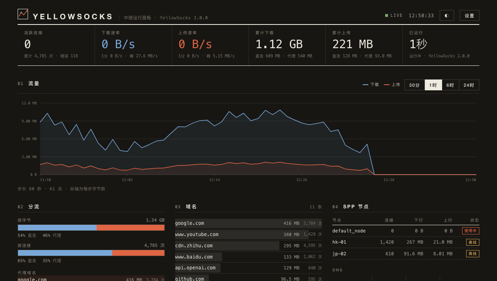

# yellowsocks

[](https://github.com/esrrhs/yellowsocks)
[](https://github.com/esrrhs/yellowsocks)
[](https://github.com/esrrhs/yellowsocks/releases)
[](https://github.com/esrrhs/yellowsocks/releases)

Linux proxy, version **2.0.0**. It serves DNS, DoT, DoH, SOCKS5, and HTTP on the local machine, and forwards proxied traffic to a remote [SPP](https://github.com/esrrhs/spp) or [pingtunnel](https://github.com/esrrhs/pingtunnel) server.

## Features

- **DNS**: standard UDP queries
- **DoH**: TCP `/dns-query` (RFC 8484, GET and POST)
- **DoT**: optional DNS-over-TLS (RFC 7858)
- **SOCKS5**: TCP CONNECT and UDP ASSOCIATE
- **HTTP proxy**: plain HTTP requests and HTTPS CONNECT
- **Upstream protocols**: forwards to [SPP](https://github.com/esrrhs/spp) (`tcp`, `udp`, `rudp`, `ricmp`, `kcp`, `quic`) or [pingtunnel](https://github.com/esrrhs/pingtunnel) (ICMP tunnel), with multi-node priority, robustness evaluation, and automatic failover
- **Routing**: domain, CIDR, and GeoIP rules choose a direct connection or upstream proxy
- **Statistics API**: live and historical traffic, connections, routing, DNS and errors over HTTP

Domestic domains and private addresses go direct. Everything else goes through the upstream proxy (SPP or pingtunnel).

## Run

Copy `config.example.yaml` to `config.yaml`, set the upstream server, then:

```bash
sudo ./yellowsocks-cli -config config.yaml
```

Or pass the server on the command line:

```bash
# SPP upstream:
sudo ./yellowsocks-cli \
  -spp-server "your_spp_server:8888" \
  -spp-proto "tcp" \
  -spp-key "123456"

# pingtunnel upstream (ICMP tunnel, requires root):
sudo ./yellowsocks-cli \
  -spp-server "your_pingtunnel_server" \
  -spp-proto "pingtunnel" \
  -spp-key "your_password"
```

Listening on port `53` and opening raw ICMP sockets require root privileges. Press `Ctrl+C` to stop.

### Flags

| Flag | Description | Default |
| :--- | :--- | :--- |
| `-config` | YAML or JSON config file | none |
| `-spp-server` | Remote SPP address or pingtunnel server host | none |
| `-spp-proto` | Upstream protocol: `tcp`, `udp`, `rudp`, `ricmp`, `kcp`, `quic`, or `pingtunnel` | `tcp` |
| `-spp-key` | SPP key or pingtunnel password (min 8 chars) | `123456` |
| `-socks5` | Inbound SOCKS5 | `127.0.0.1:1080` |
| `-http` | Inbound HTTP proxy | `127.0.0.1:8080` |
| `-dns` | DNS UDP | `127.0.0.1:53` |
| `-doh` | DoH TCP | `127.0.0.1:8053` |
| `-dot` | DoT listen address | empty, disabled |
| `-tls-cert` | DoT certificate PEM | empty |
| `-tls-key` | DoT private key PEM | empty |
| `-china-domains` | Domestic domain list | none |
| `-gfw-domains` | Proxied domain list | none |
| `-geoip` | `GeoLite2-Country.mmdb` | none |
| `-loglevel` | `debug`, `info`, `warn`, `error` | `info` |
| `-api` | Statistics HTTP API listen address | empty, disabled |
| `-api-token` | Statistics API token | random, printed at startup |
| `-stats-file` | Path persisting statistics history | `stats.json` when the API is on |
| `-v`, `-version` | Print the version and exit | |

Values in the config file override the matching flags. Multiple nodes, inbound authentication, encryption, and compression are documented in `config.example.yaml`.

### Example

```yaml
# SPP single node example:
spp_server: "1.2.3.4:8888"
spp_proto: "tcp"
spp_key: "123456"

# Or pingtunnel single node:
# spp_server: "pt.example.com"
# spp_proto: "pingtunnel"
# spp_key: "your_password"

socks5_listen: "127.0.0.1:1080"
http_listen: "127.0.0.1:8080"

dns_listen: "127.0.0.1:53"
doh_listen: "127.0.0.1:8053"
direct_dns: "114.114.114.114:53"
doh_url: "https://1.1.1.1/dns-query"
```

To enable DoT, set `dot_listen`, `tls_cert`, and `tls_key` together.

For multi-node failover (combining SPP protocols and pingtunnel fallback with priority levels and automatic failover), see `config.example.yaml`.

## Statistics API

Turn the API on with `api_listen` (or `-api`):

```yaml
api_listen: "127.0.0.1:9090"
api_token: "change-me"
api_dashboard: true      # serves a built-in page at http://127.0.0.1:9090/
stats_file: "stats.json" # counters and history survive a restart
stats_history_hours: 24  # minute-resolution history kept (max 720)
```

Every request except `/` and `/api/v1/health` needs the token, sent as
`Authorization: Bearer <token>`, as `X-API-Token: <token>`, or as a `token`
query parameter. When `api_token` is empty a random token is generated and
printed in the log at startup.

```bash
curl -H "Authorization: Bearer change-me" http://127.0.0.1:9090/api/v1/overview
```

| Endpoint | What it returns |
| :--- | :--- |
| `GET /api/v1/health` | Liveness and version (no auth) |
| `GET /api/v1/status` | Version, uptime, listeners, routing rules, upstream nodes, history window |
| `GET /api/v1/overview` | Active connections, cumulative and per-path counters, current and peak speed |
| `GET /api/v1/connections` | Live sessions: client, target, decision, bytes, age |
| `GET /api/v1/traffic` | History series, `range=30m\|1h\|6h\|24h\|7d`, `step=1m\|5m\|15m\|1h` |
| `GET /api/v1/domains` | Domain distribution, `limit`, `order=bytes\|conns` |
| `GET /api/v1/routes` | Direct vs SPP split with the busiest domains on each side |
| `GET /api/v1/dns` | Query counts, cache hits, upstream usage, failures, top queried domains |
| `GET /api/v1/errors` | Rolling error log, `limit`, `scope=dns\|socks5\|http\|spp` |
| `GET /api/v1/nodes` | Per-node liveness and traffic (SPP and pingtunnel) |
| `GET /api/v1/snapshot` | Everything at once, for export |
| `POST /api/v1/reset` | Clears counters and history |

Byte direction is named from the relay's point of view:

- `upload_bytes` — client to target (what the client sends out)
- `download_bytes` — target to client (what the client receives)

`connections` accepts `proto`, `decision` and `host` filters plus `limit`
(<=1000). CORS is enabled for browser callers; restrict it with
`api_origins`.

### Dashboard page

The proxy ships a dashboard (`dashboard/index.html`) and serves it at
`http://<api_listen>/` when `api_dashboard` is true.

The page is one standalone HTML file: no build step, no CDN, no web font,
no chart library. It does not have to be served by the proxy — copy it
anywhere (a static host, another machine, even `file://`) and fill in the
two boxes behind **Settings**:

- **API Address** — the API address of the relay, e.g. `http://1.2.3.4:9090`.
  Leave it empty to talk to whoever serves the page (same origin).
- **Token** — the token configured on that relay.

Both are kept in `localStorage` and can be pre-filled from the URL, which
is handy for a bookmark or a shared link:

```
http://dashboard-host/index.html?server=http://1.2.3.4:9090&token=change-me&theme=dark
```

A page served from another origin needs CORS on the relay side: keep
`api_origins: ["*"]`, or list the page's origin explicitly.
See [dashboard/README.md](dashboard/README.md) for the page's own notes.


<details>
<summary>Dark Theme</summary>



</details>

Both screenshots show synthetic demo data.

## Deploying the page away from the relay

A page that anyone can read cannot hold a secret. If the dashboard is
hosted on machine A and the API on machine B, **never put B's address and
token in the page**: a visitor only has to open the source to get them.

Let the browser talk only to A, and let A talk to B:

```
browser ──> A: page + reverse proxy ──> B: yellowsocks API
                    (holds the token)        (only accepts A)
```

The page calls `/api/v1/...` on its own origin (leave the server box
empty), A proxies that path to B and injects the token on the way. The
token lives in A's server configuration, never in anything the browser
receives.

On A (nginx), with the token kept in a file readable only by root:

```nginx
server {
    listen 443 ssl;
    server_name status.example.com;
    root /var/www/yellowsocks;          # dashboard/index.html as index.html

    # Optional: your own login in front of the page.
    # auth_basic "status";
    # auth_basic_user_file /etc/nginx/status.htpasswd;

    location /api/ {
        proxy_pass http://10.0.0.2:9090;                    # B
        proxy_set_header Authorization "Bearer $ys_api_token";
        proxy_set_header X-Forwarded-For $proxy_add_x_forwarded_for;
    }
}
```

On B (`config.yaml`), accept only A:

```yaml
api_listen: "10.0.0.2:9090"          # or 0.0.0.0 with a firewall allowing only A
api_token: "<long random string>"    # given to the proxy, not to the page
api_allowed_cidrs: ["10.0.0.1/32"]   # reject everyone else, token or not
api_trusted_proxies: ["10.0.0.1/32"] # honor A's X-Forwarded-For
api_origins: ["none"]                # calls arrive same-origin, no CORS needed
```

`api_allowed_cidrs` is checked before the token, so B answers 403 to any
other host even with a valid token. It gates on the **peer that connected**
(the proxy), not on forwarding headers, so it keeps working no matter what
`X-Forwarded-For` the proxy sends. `X-Forwarded-For` is only honored from
`api_trusted_proxies`; add `api_client_cidrs` if you also want to filter
the visitors behind the proxy, and nobody can forge their way past either
list.

**If you cannot put a reverse proxy in front** (a dumb static host), give
the page `api_readonly_token` instead of the admin token, and accept what
that means: the page can read but not reset, and the API host stays
reachable from the browser, so also set `api_allowed_cidrs` as tightly as
you can and rate-limit at the edge. A read-only token is damage control,
not a substitute for the proxy.

## Benchmarks

The forwarding path and the routing decision are covered by benchmarks.
Run them on the host you actually serve from: loopback on a laptop is
syscall bound and hides most of the cost.

```bash
go test ./core/proxy ./core/router ./core/stats -run XXX -bench . -benchmem
```

- `BenchmarkSocks5Throughput` - bulk transfer over one connection.
- `BenchmarkSocks5Concurrent` - many connections at once, statistics on:
  the case a busy relay actually runs in.
- `BenchmarkSocks5Connections` - per-connection cost of handshake, routing
  and setup.
- `BenchmarkDecideDomain` / `BenchmarkDecideIP` - one routing decision,
  taken on every connection, UDP datagram and DNS query.

Run `BenchmarkLoggoInfo` on its own (`-bench LoggoInfo`): it has to be the
one that initialises logging, and it prints a line per iteration.

## Profiling a running relay

Set `api_pprof: true` (or pass `-api-pprof`) to serve the runtime profiles
at `/debug/pprof/`. They need the admin token, the same as `reset`, so the
readonly token cannot reach them. Turn it on while you are looking at a hot
path and off afterwards: a heap profile names the domains being relayed and
a goroutine dump shows the live connections.

```bash
# 30s CPU profile of the live process
curl -H "Authorization: Bearer $TOKEN" \
  "http://127.0.0.1:9090/debug/pprof/profile?seconds=30" -o cpu.out
go tool pprof -http=:0 cpu.out

# where the memory goes
curl -H "Authorization: Bearer $TOKEN" \
  "http://127.0.0.1:9090/debug/pprof/heap" -o heap.out
go tool pprof -sample_index=alloc_space -http=:0 heap.out
```

`/debug/pprof/profile` and `/debug/pprof/trace` hold the connection open for
as long as they run; the write timeout is lifted for these routes, so a
30-second profile is not cut off.

## Build

```bash
./pack.sh
```

Archives are written to `pack/`:

- `yellowsocks_linux_amd64.zip`
- `yellowsocks_linux_arm64.zip`
- `yellowsocks_linux_arm.zip`

Each archive contains `yellowsocks-cli` and `config.example.yaml`.

## License

MIT
