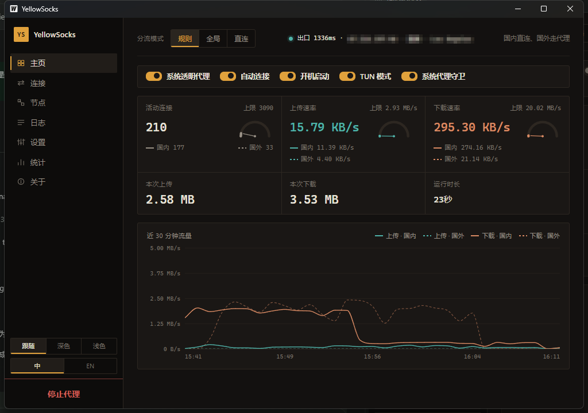

# yellowsocks

[English](README.md) | **简体中文**

[](https://github.com/esrrhs/yellowsocks)
[](https://github.com/esrrhs/yellowsocks)
[](https://github.com/esrrhs/yellowsocks/releases)
[](https://github.com/esrrhs/yellowsocks/releases)
[](https://github.com/esrrhs/yellowsocks/actions)
[](https://codecov.io/gh/esrrhs/yellowsocks)

DNS、DoH、DoT、SOCKS5 和 HTTP 代理。国内域名与私有地址直连，其余流量按域名、
CIDR 和 GeoIP 路由规则转发到远端
[SPP](https://github.com/esrrhs/spp) 或
[pingtunnel](https://github.com/esrrhs/pingtunnel) 服务器。同一引擎同时提供
Windows 桌面客户端与 Linux 命令行。

## Windows 客户端



- **一个窗口看全部**：实时连接、上传下载速率（速度表盘显示与历史峰值的差距）、
  路由模式，以及国内/国外分开的 30 分钟流量曲线。
- **系统代理**一键开关并带守护，引擎停止时恢复之前的设置；**TUN 模式**通过
  Wintun 适配器和 fake-ip DNS 接管绕过系统代理的游戏和命令行工具。
- **托盘与后台**：启动/停止、系统代理、TUN 和路由模式都能在托盘菜单里切换；
  关闭窗口即收进托盘。
- **互相拉起**：随附的 `yellowsocks-watchdog.exe` 与主程序互为守护，任何一方
  退出，另一方都会在几秒内把它拉起；更新时两者一起退出、一起换新，TUN 提权
  交接则保持守护进程存活。
- **便携**：`yellowsocks-gui.exe`、`wintun.dll` 和 `config.yaml` 放在一个文件夹
  即可运行，设置、日志和统计也保存在旁边。

逐页功能说明见 [WINDOWS.zh-CN.md](WINDOWS.zh-CN.md)。

## 命令行

Linux 无头转发。复制 `config.example.yaml` 为 `config.yaml`，填好上游服务器，然后：

```bash
sudo ./yellowsocks-cli -config config.yaml
```

或在命令行直接传入服务器：

```bash
sudo ./yellowsocks-cli -spp-server "your_spp_server:8888" -spp-proto tcp -spp-key "123456"
```

本地提供 DNS（`:53`）、DoH（`:8053`）、SOCKS5（`:1080`）和 HTTP（`:8080`）；
监听 53 端口和 ICMP 上游需要 root。完整配置、参数列表、统计 API 和面板见
[USAGE.zh-CN.md](USAGE.zh-CN.md)。
