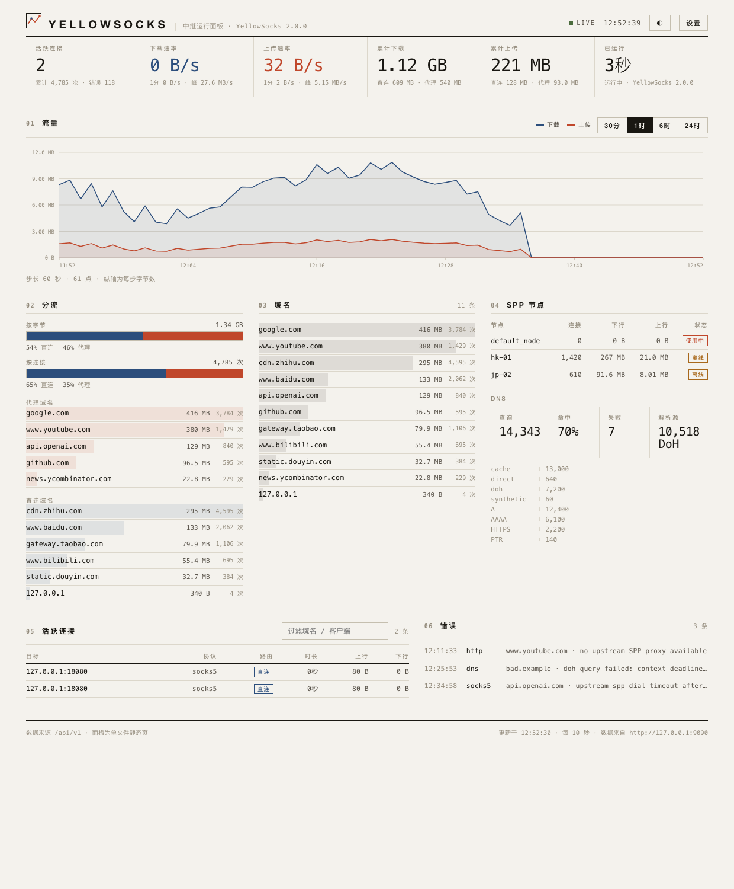
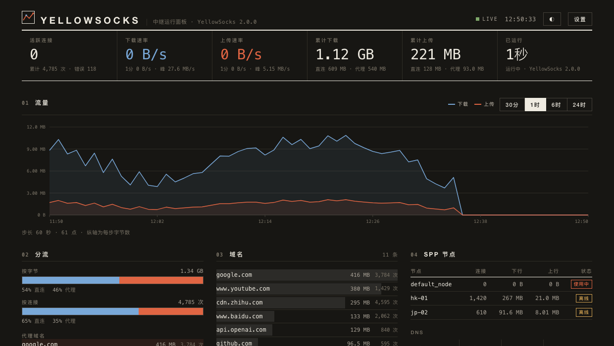

# Usage

Both clients run the same engine: the CLI exposes it directly on Linux, the
Windows app adds a desktop UI, system proxy and TUN capture. The config file,
the routing rules and the statistics API are identical.

- [CLI](#cli)
  - [Quick start](#quick-start)
  - [Configuration](#configuration)
  - [Flags](#flags)
  - [Statistics API](#statistics-api)
  - [Dashboard page](#dashboard-page)
  - [Deploying the page away from the relay](#deploying-the-page-away-from-the-relay)
- [Windows client](#windows-client)
  - [TUN mode](#tun-mode)
  - [Building the Windows GUI](#building-the-windows-gui)
- [Profiling a running relay](#profiling-a-running-relay)
- [Benchmarks](#benchmarks)

## CLI

### Quick start

Copy `config.example.yaml` to `config.yaml`, set the upstream server, then:

```bash
sudo ./yellowsocks-cli -config config.yaml
```

Or pass the server on the command line:

```bash
# SPP upstream:
sudo ./yellowsocks-cli \
  -spp-server "your_spp_server:8888" \
  -spp-proto "tcp" \
  -spp-key "123456"

# pingtunnel upstream (ICMP tunnel, requires root):
sudo ./yellowsocks-cli \
  -spp-server "your_pingtunnel_server" \
  -spp-proto "pingtunnel" \
  -spp-key "your_password"
```

Listening on port `53` and opening raw ICMP sockets require root privileges.
Press `Ctrl+C` to stop.

### Configuration

```yaml
# SPP single node example:
spp_server: "1.2.3.4:8888"
spp_proto: "tcp"
spp_key: "123456"

# Or pingtunnel single node:
# spp_server: "pt.example.com"
# spp_proto: "pingtunnel"
# spp_key: "your_password"

socks5_listen: "127.0.0.1:1080"
http_listen: "127.0.0.1:8080"

dns_listen: "127.0.0.1:53"
doh_listen: "127.0.0.1:8053"
direct_dns: "114.114.114.114:53"
doh_url: "https://1.1.1.1/dns-query"
```

To enable DoT, set `dot_listen`, `tls_cert`, and `tls_key` together.

For multi-node failover (combining SPP protocols and pingtunnel fallback with
priority levels and automatic failover), see `config.example.yaml`.

### Flags

| Flag | Description | Default |
| :--- | :--- | :--- |
| `-config` | YAML or JSON config file | none |
| `-spp-server` | Remote SPP address or pingtunnel server host | none |
| `-spp-proto` | Upstream protocol: `tcp`, `udp`, `rudp`, `ricmp`, `kcp`, `quic`, `rhttp`, `rdns`, or `pingtunnel` | `tcp` |
| `-spp-key` | SPP key or pingtunnel password (min 8 chars) | `123456` |
| `-spp-rdnsdomain` | RDNS base tunnel domain (e.g. `tunnel.example.com`; required when spp-proto is rdns) | none |
| `-spp-rdnsupstream` | RDNS upstream DNS server for non-tunnel queries | empty |
| `-spp-rdnspsk` | RDNS underlay AES-GCM PSK payload encryption key | empty |
| `-spp-rdnsquerytype` | RDNS query type: `TXT` or `NULL` | `TXT` |
| `-socks5` | Inbound SOCKS5 | `127.0.0.1:1080` |
| `-http` | Inbound HTTP proxy | `127.0.0.1:8080` |
| `-dns` | DNS UDP | `127.0.0.1:53` |
| `-doh` | DoH TCP | `127.0.0.1:8053` |
| `-dot` | DoT listen address | empty, disabled |
| `-tls-cert` | DoT certificate PEM | empty |
| `-tls-key` | DoT private key PEM | empty |
| `-china-domains` | Domestic domain list | none |
| `-gfw-domains` | Proxied domain list | none |
| `-geoip` | `GeoLite2-Country.mmdb` | none |
| `-skip-country` | Skip country ISO code(s) for direct routing bypass, comma-separated (e.g. `CN`, `CN,HK`, or `none`) | `CN` |
| `-loglevel` | `debug`, `info`, `warn`, `error` | `info` |
| `-api` | Statistics HTTP API listen address | empty, disabled |
| `-api-token` | Statistics API token | random, printed at startup |
| `-stats-file` | Path persisting statistics history | `stats.json` when the API is on |
| `-v`, `-version` | Print the version and exit | |

Values in the config file override the matching flags. Multiple nodes, inbound
authentication, encryption, and compression are documented in
`config.example.yaml`.

### Statistics API

Turn the API on with `api_listen` (or `-api`):

```yaml
api_listen: "127.0.0.1:9090"
api_token: "change-me"
api_dashboard: true      # serves a built-in page at http://127.0.0.1:9090/
stats_file: "stats.json" # counters and history survive a restart
stats_history_hours: 24  # minute-resolution history kept (max 720)
```

Every request except `/` and `/api/v1/health` needs the token, sent as
`Authorization: Bearer <token>`, as `X-API-Token: <token>`, or as a `token`
query parameter. When `api_token` is empty a random token is generated and
printed in the log at startup.

```bash
curl -H "Authorization: Bearer change-me" http://127.0.0.1:9090/api/v1/overview
```

| Endpoint | What it returns |
| :--- | :--- |
| `GET /api/v1/health` | Liveness and version (no auth) |
| `GET /api/v1/status` | Version, uptime, listeners, routing rules, upstream nodes, history window |
| `GET /api/v1/overview` | Active connections, cumulative and per-path counters, current and peak speed |
| `GET /api/v1/connections` | Live sessions: client, target, decision, bytes, age |
| `GET /api/v1/traffic` | History series, `range=30m\|1h\|6h\|24h\|7d`, `step=1m\|5m\|15m\|1h` |
| `GET /api/v1/domains` | Domain distribution, `limit`, `order=bytes\|conns` |
| `GET /api/v1/routes` | Direct vs SPP split with the busiest domains on each side |
| `GET /api/v1/dns` | Query counts, cache hits, upstream usage, failures, top queried domains |
| `GET /api/v1/errors` | Rolling error log, `limit`, `scope=dns\|socks5\|http\|spp` |
| `GET /api/v1/nodes` | Per-node liveness and traffic (SPP and pingtunnel) |
| `GET /api/v1/snapshot` | Everything at once, for export |
| `POST /api/v1/reset` | Clears counters and history |

Byte direction is named from the relay's point of view:

- `upload_bytes` — client to target (what the client sends out)
- `download_bytes` — target to client (what the client receives)

`connections` accepts `proto`, `decision` and `host` filters plus `limit`
(<=1000). CORS is enabled for browser callers; restrict it with
`api_origins`.

#### Dashboard page

The proxy ships a dashboard (`dashboard/index.html`) and serves it at
`http://<api_listen>/` when `api_dashboard` is true.

The page is one standalone HTML file: no build step, no CDN, no web font,
no chart library. It does not have to be served by the proxy — copy it
anywhere (a static host, another machine, even `file://`) and fill in the
two boxes behind **Settings**:

- **API Address** — the API address of the relay, e.g. `http://1.2.3.4:9090`.
  Leave it empty to talk to whoever serves the page (same origin).
- **Token** — the token configured on that relay.

Both are kept in `localStorage` and can be pre-filled from the URL, which
is handy for a bookmark or a shared link:

```
http://dashboard-host/index.html?server=http://1.2.3.4:9090&token=change-me&theme=dark
```

A page served from another origin needs CORS on the relay side: keep
`api_origins: ["*"]`, or list the page's origin explicitly.
See [dashboard/README.md](dashboard/README.md) for the page's own notes.



<details>
<summary>Dark Theme</summary>



</details>

Both screenshots show synthetic demo data.

#### Deploying the page away from the relay

A page that anyone can read cannot hold a secret. If the dashboard is
hosted on machine A and the API on machine B, **never put B's address and
token in the page**: a visitor only has to open the source to get them.

Let the browser talk only to A, and let A talk to B:

```
browser ──> A: page + reverse proxy ──> B: yellowsocks API
                    (holds the token)        (only accepts A)
```

The page calls `/api/v1/...` on its own origin (leave the server box
empty), A proxies that path to B and injects the token on the way. The
token lives in A's server configuration, never in anything the browser
receives.

On A (nginx), with the token kept in a file readable only by root:

```nginx
server {
    listen 443 ssl;
    server_name status.example.com;
    root /var/www/yellowsocks;          # dashboard/index.html as index.html

    # Optional: your own login in front of the page.
    # auth_basic "status";
    # auth_basic_user_file /etc/nginx/status.htpasswd;

    location /api/ {
        proxy_pass http://10.0.0.2:9090;                    # B
        proxy_set_header Authorization "Bearer $ys_api_token";
        proxy_set_header X-Forwarded-For $proxy_add_x_forwarded_for;
    }
}
```

On B (`config.yaml`), accept only A:

```yaml
api_listen: "10.0.0.2:9090"          # or 0.0.0.0 with a firewall allowing only A
api_token: "<long random string>"    # given to the proxy, not to the page
api_allowed_cidrs: ["10.0.0.1/32"]   # reject everyone else, token or not
api_trusted_proxies: ["10.0.0.1/32"] # honor A's X-Forwarded-For
api_origins: ["none"]                # calls arrive same-origin, no CORS needed
```

`api_allowed_cidrs` is checked before the token, so B answers 403 to any
other host even with a valid token. It gates on the **peer that connected**
(the proxy), not on forwarding headers, so it keeps working no matter what
`X-Forwarded-For` the proxy sends. `X-Forwarded-For` is only honored from
`api_trusted_proxies`; add `api_client_cidrs` if you also want to filter
the visitors behind the proxy, and nobody can forge their way past either
list.

**If you cannot put a reverse proxy in front** (a dumb static host), give
the page `api_readonly_token` instead of the admin token, and accept what
that means: the page can read but not reset, and the API host stays
reachable from the browser, so also set `api_allowed_cidrs` as tightly as
you can and rate-limit at the edge. A read-only token is damage control,
not a substitute for the proxy.

## Windows client

The Windows app (`windows/`) is the same engine behind a tray icon, a system
proxy switch, auto-connect, launch-at-login and TUN capture. `config.yaml`,
`wintun.dll` and `yellowsocks-gui.exe` in one directory are a complete
installation; `settings.json`, the logs and `stats.json` land next to them.

### TUN mode

The Windows client can capture all system traffic through a Wintun adapter
(tun2socks → the engine's own SOCKS5 inbound), so games, launchers and CLI
tools that ignore the system proxy are proxied too.

- **Requires administrator rights.** Toggling it on from an unelevated window
  prompts for UAC once; the adapter cannot be created otherwise.
- **Foreign traffic goes through name, not address.** Proxied domains get an
  address from the fake-ip pool (`198.18.0.0/15`); when the client connects to
  it, the engine recovers the original domain and forwards *that* to the
  upstream SOCKS5 (`spp_proto: socks5`, `spp_server: <host:port>`), which
  resolves it remotely. This is what makes DNS pollution and IP blocking
  irrelevant — the same approach Clash Verge takes.
- **Domestic traffic stays direct** and keeps using the real resolver.

Safety nets, in the order they engage:

| Layer | What it covers |
| --- | --- |
| Pipeline probe | An HTTPS fetch through the full capture path right after bring-up, then every 15s. Three consecutive failures roll the adapter back so the machine returns to its own default route. |
| International probe | Resolves a proxied name (must be a fake-ip) and connects to it. Failures are reported, never rolled back: a dead upstream must not take the working domestic path down with it. |
| Bring-up guard | If `enable` has not finished within 60s (hung wintun call, wedged route transaction), an independent goroutine unwinds the routing state. |
| Lock-free forced teardown | A stuck bring-up holds the state lock; disabling would block forever on it. Disable, the guard and shutdown all fall back to a path that never takes that lock and re-discovers the adapter from the OS. |
| DNS take-over journal | The resolver lists replaced by the take-over are written to `tun-dns-state.json` before they are touched and deleted after they are restored; a leftover file (crash, power loss) is replayed by the next bring-up. |
| Process-bound adapter | The adapter is a SwDevice owned by the process, so it — and its routes — disappear with a hard crash even if none of the above ran. |

`windows/tuntest` is the privileged acceptance driver: `yellowsocks-tuntest.exe
-auto` brings the adapter up, walks DNS → TCP → HTTPS for a domestic and a
proxied host, traces the fake-ip handshake with pktmon, and tears everything
down again, writing a full report to `tuntest-out.log`.

### Building the Windows GUI

```bash
cd windows
wails build -o yellowsocks-gui.exe -ldflags "-H windowsgui -s -w"
```

Use `wails build`, not `go build`: it is what embeds the icon
(`build/windows/icon.ico`) and the manifest, so the exe, the taskbar button and
alt-tab all get the real icon instead of the generic Go one. `-o` picks the
output name, which is also how you rebuild while a copy of the app is running —
the running exe is locked and cannot be overwritten in place.

The result is portable: `yellowsocks-gui.exe`, `wintun.dll` and `config.yaml`
next to each other are a complete installation, settings and logs land in the
same directory.

## Profiling a running relay

Set `api_pprof: true` (or pass `-api-pprof`) to serve the runtime profiles
at `/debug/pprof/`. They need the admin token, the same as `reset`, so the
readonly token cannot reach them. Turn it on while you are looking at a hot
path and off afterwards: a heap profile names the domains being relayed and
a goroutine dump shows the live connections.

```bash
# 30s CPU profile of the live process
curl -H "Authorization: Bearer $TOKEN" \
  "http://127.0.0.1:9090/debug/pprof/profile?seconds=30" -o cpu.out
go tool pprof -http=:0 cpu.out

# where the memory goes
curl -H "Authorization: Bearer $TOKEN" \
  "http://127.0.0.1:9090/debug/pprof/heap" -o heap.out
go tool pprof -sample_index=alloc_space -http=:0 heap.out
```

`/debug/pprof/profile` and `/debug/pprof/trace` hold the connection open for
as long as they run; the write timeout is lifted for these routes, so a
30-second profile is not cut off.

## Benchmarks

The forwarding path and the routing decision are covered by benchmarks.
Run them on the host you actually serve from: loopback on a laptop is
syscall bound and hides most of the cost.

```bash
go test ./core/proxy ./core/router ./core/stats -run XXX -bench . -benchmem
```

- `BenchmarkSocks5Throughput` - bulk transfer over one connection.
- `BenchmarkSocks5Concurrent` - many connections at once, statistics on:
  the case a busy relay actually runs in.
- `BenchmarkSocks5Connections` - per-connection cost of handshake, routing
  and setup.
- `BenchmarkDecideDomain` / `BenchmarkDecideIP` - one routing decision,
  taken on every connection, UDP datagram and DNS query.

Run `BenchmarkLoggoInfo` on its own (`-bench LoggoInfo`): it has to be the
one that initialises logging, and it prints a line per iteration.