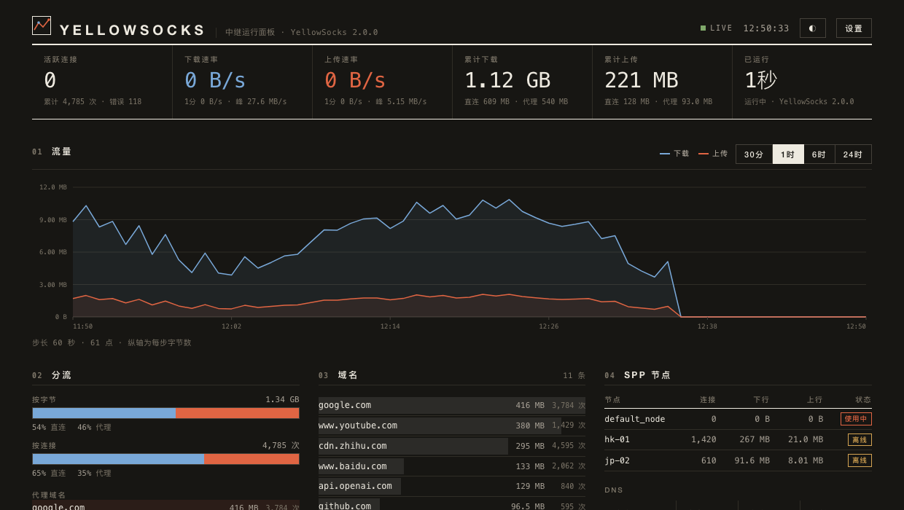

# 使用说明

[English](USAGE.md) | **简体中文**

两个客户端共用同一引擎：命令行在 Linux 上直接运行引擎，Windows 客户端在其上加了一层桌面界面、系统代理和 TUN 捕获。配置文件、路由规则和统计 API 完全一致。

- [命令行](#命令行)
  - [快速开始](#快速开始)
  - [配置](#配置)
  - [参数](#参数)
  - [统计 API](#统计-api)
  - [面板页面](#面板页面)
  - [把面板部署到中继之外](#把面板部署到中继之外)
- [Windows 客户端](#windows-客户端)
  - [TUN 模式](#tun-模式)
  - [构建 Windows GUI](#构建-windows-gui)
- [对运行中的中继做性能剖析](#对运行中的中继做性能剖析)
- [基准测试](#基准测试)

## 命令行

### 快速开始

把 `config.example.yaml` 复制为 `config.yaml`，填好上游服务器，然后：

```bash
sudo ./yellowsocks-cli -config config.yaml
```

或者直接在命令行传入服务器：

```bash
# SPP 上游：
sudo ./yellowsocks-cli \
  -spp-server "your_spp_server:8888" \
  -spp-proto "tcp" \
  -spp-key "123456"

# pingtunnel 上游（ICMP 隧道，需要 root）：
sudo ./yellowsocks-cli \
  -spp-server "your_pingtunnel_server" \
  -spp-proto "pingtunnel" \
  -spp-key "your_password"
```

监听 53 端口和打开原始 ICMP socket 都需要 root 权限。按 `Ctrl+C` 停止。

### 配置

```yaml
# SPP 单节点示例：
spp_server: "1.2.3.4:8888"
spp_proto: "tcp"
spp_key: "123456"

# 或者 pingtunnel 单节点：
# spp_server: "pt.example.com"
# spp_proto: "pingtunnel"
# spp_key: "your_password"

socks5_listen: "127.0.0.1:1080"
http_listen: "127.0.0.1:8080"

dns_listen: "127.0.0.1:53"
doh_listen: "127.0.0.1:8053"
direct_dns: "114.114.114.114:53"
doh_url: "https://1.1.1.1/dns-query"
```

要启用 DoT，请同时设置 `dot_listen`、`tls_cert` 和 `tls_key`。

多节点故障转移（把多种 SPP 协议和 pingtunnel 兜底结合起来，带优先级和自动切换）见 `config.example.yaml`。

### 参数

| 参数 | 说明 | 默认值 |
| :--- | :--- | :--- |
| `-config` | YAML 或 JSON 配置文件 | 无 |
| `-spp-server` | 远端 SPP 地址或 pingtunnel 服务器主机 | 无 |
| `-spp-proto` | 上游协议：`tcp`、`udp`、`rudp`、`ricmp`、`kcp`、`quic`、`rhttp`、`rdns` 或 `pingtunnel` | `tcp` |
| `-spp-key` | SPP 密钥或 pingtunnel 密码（至少 8 个字符） | `123456` |
| `-spp-rdnsdomain` | RDNS 基础隧道域名（如 `tunnel.example.com`；`spp-proto` 为 `rdns` 时必填） | 无 |
| `-spp-rdnsupstream` | 非隧道查询使用的 RDNS 上游 DNS 服务器 | 空 |
| `-spp-rdnspsk` | RDNS 底层 AES-GCM PSK 载荷加密密钥 | 空 |
| `-spp-rdnsquerytype` | RDNS 查询类型：`TXT` 或 `NULL` | `TXT` |
| `-socks5` | SOCKS5 入站监听 | `127.0.0.1:1080` |
| `-http` | HTTP 代理入站监听 | `127.0.0.1:8080` |
| `-dns` | DNS UDP 监听 | `127.0.0.1:53` |
| `-doh` | DoH TCP 监听 | `127.0.0.1:8053` |
| `-dot` | DoT 监听地址 | 空，禁用 |
| `-tls-cert` | DoT 证书 PEM | 空 |
| `-tls-key` | DoT 私钥 PEM | 空 |
| `-china-domains` | 国内域名列表 | 无 |
| `-gfw-domains` | 需要代理的域名列表 | 无 |
| `-geoip` | `GeoLite2-Country.mmdb` | 无 |
| `-skip-country` | 直连时跳过的国家 ISO 代码，逗号分隔（如 `CN`、`CN,HK` 或 `none`） | `CN` |
| `-loglevel` | `debug`、`info`、`warn`、`error` | `info` |
| `-api` | 统计 HTTP API 监听地址 | 空，禁用 |
| `-api-token` | 统计 API 令牌 | 随机生成，启动时打印 |
| `-stats-file` | 统计历史的持久化路径 | API 开启时为 `stats.json` |
| `-v`、`-version` | 打印版本并退出 | |

配置文件中的值优先于对应参数。多节点、入站认证、加密和压缩在 `config.example.yaml` 中有完整说明。

### 统计 API

通过 `api_listen`（或 `-api`）开启：

```yaml
api_listen: "127.0.0.1:9090"
api_token: "change-me"
api_dashboard: true      # 在 http://127.0.0.1:9090/ 提供内置面板
stats_file: "stats.json" # 计数和历史在重启后保留
stats_history_hours: 24  # 保留的分钟级历史（最大 720）
```

除 `/` 和 `/api/v1/health` 外的每个请求都需要令牌，可以放在 `Authorization: Bearer <token>`、`X-API-Token: <token>` 或 `token` 查询参数里。`api_token` 为空时会生成随机令牌并在启动日志中打印。

```bash
curl -H "Authorization: Bearer change-me" http://127.0.0.1:9090/api/v1/overview
```

| 端点 | 返回内容 |
| :--- | :--- |
| `GET /api/v1/health` | 存活状态和版本（无需认证） |
| `GET /api/v1/status` | 版本、运行时长、监听器、路由规则、上游节点、历史窗口 |
| `GET /api/v1/overview` | 活跃连接数、累计和分路计数、当前与峰值速率 |
| `GET /api/v1/connections` | 实时会话：客户端、目标、决策、字节数、存活时长 |
| `GET /api/v1/traffic` | 历史序列，`range=30m\|1h\|6h\|24h\|7d`，`step=1m\|5m\|15m\|1h` |
| `GET /api/v1/domains` | 域名分布，`limit`，`order=bytes\|conns` |
| `GET /api/v1/routes` | 直连与 SPP 分流，以及两侧最繁忙的域名 |
| `GET /api/v1/dns` | 查询计数、缓存命中、上游使用、失败、查询最多的域名 |
| `GET /api/v1/errors` | 滚动错误日志，`limit`，`scope=dns\|socks5\|http\|spp` |
| `GET /api/v1/nodes` | 各节点存活状态与流量（SPP 与 pingtunnel） |
| `GET /api/v1/snapshot` | 一次性返回全部数据，便于导出 |
| `POST /api/v1/reset` | 清空计数和历史 |

字节方向以中继的视角命名：

- `upload_bytes` —— 客户端到目标（客户端发出的流量）
- `download_bytes` —— 目标到客户端（客户端收到的流量）

`connections` 支持 `proto`、`decision` 和 `host` 过滤，以及 `limit`（<=1000）。对浏览器调用方开启 CORS；可以通过 `api_origins` 收紧。

#### 面板页面

代理内置一个面板（`dashboard/index.html`），`api_dashboard` 为 true 时在 `http://<api_listen>/` 提供。

页面是单个独立的 HTML 文件：无需构建、无 CDN、无 Web 字体、无图表库。它不必由代理提供——复制到任何地方（静态托管、另一台机器，甚至 `file://`），然后在 **设置** 里填写两个输入框：

- **API 地址** —— 中继的 API 地址，例如 `http://1.2.3.4:9090`。留空则与提供页面的服务通信（同源）。
- **令牌** —— 该中继上配置的令牌。

两项都保存在 `localStorage`，也可以从 URL 预填，方便收藏或分享链接：

```
http://dashboard-host/index.html?server=http://1.2.3.4:9090&token=change-me&theme=dark
```

从其他源提供的页面需要中继侧开启 CORS：保持 `api_origins: ["*"]`，或显式列上页面的源。页面自身的说明见 [dashboard/README.md](dashboard/README.md)。


<details>
<summary>深色主题</summary>



</details>

两张截图都是合成的演示数据。

#### 把面板部署到中继之外

任何人都能读到的页面藏不住秘密。如果面板托管在机器 A、API 在机器 B，**绝不要把 B 的地址和令牌放进页面**：访客点开源码就能拿到。

让浏览器只与 A 通信，由 A 与 B 通信：

```
浏览器 ──> A：页面 + 反向代理 ──> B：yellowsocks API
              （持有令牌）           （只接受 A）
```

页面向自己的源请求 `/api/v1/...`（服务器地址留空），A 把这些路径转发到 B 并在途中注入令牌。令牌只存在于 A 的服务端配置里，浏览器收到的任何内容都不包含它。

在 A 上（nginx），令牌放在只有 root 可读的文件里：

```nginx
server {
    listen 443 ssl;
    server_name status.example.com;
    root /var/www/yellowsocks;          # dashboard/index.html 作为 index.html

    # 可选：在页面之前加一层自己的登录。
    # auth_basic "status";
    # auth_basic_user_file /etc/nginx/status.htpasswd;

    location /api/ {
        proxy_pass http://10.0.0.2:9090;                    # B
        proxy_set_header Authorization "Bearer $ys_api_token";
        proxy_set_header X-Forwarded-For $proxy_add_x_forwarded_for;
    }
}
```

在 B 上（`config.yaml`），只接受 A：

```yaml
api_listen: "10.0.0.2:9090"          # 或 0.0.0.0，用防火墙只放行 A
api_token: "<long random string>"    # 交给代理，不交给页面
api_allowed_cidrs: ["10.0.0.1/32"]   # 其余一律拒绝，不论令牌
api_trusted_proxies: ["10.0.0.1/32"] # 信任 A 的 X-Forwarded-For
api_origins: ["none"]                # 同源调用，无需 CORS
```

`api_allowed_cidrs` 在检查令牌之前生效，所以 B 对其他主机一律回 403，即使令牌有效。它检查的是**建立连接的对方**（代理），而不是转发头，因此无论代理发什么 `X-Forwarded-For` 都可靠。只有来自 `api_trusted_proxies` 的 `X-Forwarded-For` 才会被采信；如果想进一步过滤代理后面的访客，加 `api_client_cidrs`，两个列表都无法伪造绕过。

**如果没法在前面放反向代理**（比如纯静态托管），给页面配 `api_readonly_token` 而不是管理令牌，并接受它的含义：页面只能读不能重置，且 API 主机对浏览器仍然可达，所以要尽量收紧 `api_allowed_cidrs` 并在边缘限速。只读令牌是止损手段，不能替代反向代理。

## Windows 客户端

Windows 客户端（`windows/`）是同一引擎加上托盘图标、系统代理开关、自动连接、开机启动和 TUN 捕获。`config.yaml`、`wintun.dll`、`yellowsocks-gui.exe` 和 `yellowsocks-watchdog.exe` 放在同一目录就是完整安装；`settings.json`、日志和 `stats.json` 也落在旁边。

### TUN 模式

Windows 客户端可以通过 Wintun 适配器接管全部系统流量（tun2socks → 引擎自己的 SOCKS5 入站），这样忽略系统代理的游戏、启动器和命令行工具也会被代理。

- **需要管理员权限。** 在未提权的窗口里打开会弹一次 UAC；否则适配器无法创建。
- **国外流量按域名而不是按地址走。** 被代理的域名从 fake-ip 池（`198.18.0.0/15`）拿到一个地址；客户端连接它时，引擎还原出原始域名，并把*域名*交给上游 SOCKS5（`spp_proto: socks5`，`spp_server: <host:port>`），由上游远端解析。DNS 污染和 IP 封锁因此失效——Clash Verge 用的也是同样的思路。
- **国内流量保持直连**，继续使用真实 DNS。

安全网，按生效顺序：

| 层 | 覆盖什么 |
| --- | --- |
| 链路探测 | 拉起后立即通过完整捕获链路做一次 HTTPS 请求，之后每 15 秒一次。连续三次失败回滚适配器，机器恢复自己的默认路由。 |
| 国际探测 | 解析一个被代理的域名（必须是 fake-ip）并连接它。失败只上报，不回滚：上游挂了不能把正常的国内链路一起带下去。 |
| 拉起保护 | `enable` 超过 60 秒未完成（wintun 调用卡死、路由事务卡住）时，独立的 goroutine 回收路由状态。 |
| 无锁强制拆除 | 卡住的拉起会持有状态锁，禁用操作会永久阻塞。禁用、保护器和退出都走一条不取该锁、从系统重新发现适配器的路径。 |
| DNS 接管日志 | 接管前把被替换的 DNS 服务器列表写入 `tun-dns-state.json`，恢复后删除；遗留文件（崩溃、断电）由下一次拉起重放。 |
| 进程绑定适配器 | 适配器是进程持有的 SwDevice，即使上面所有机制都没跑，硬崩溃也会带走它和它的路由。 |

`windows/tuntest` 是特权验收驱动：`yellowsocks-tuntest.exe -auto` 拉起适配器，对国内和国外主机走一遍 DNS → TCP → HTTPS，用 pktmon 跟踪 fake-ip 握手，然后全部拆除，并把完整报告写入 `tuntest-out.log`。

### 构建 Windows GUI

```bash
cd windows
./build.sh
```

`build.sh` 会用 About 页面所需的版本信息调用 `wails build`，然后把 `yellowsocks-watchdog.exe` 构建到主程序旁边。请用 `wails build` 而不是 `go build`：图标（`build/windows/icon.ico`）和 manifest 都由它嵌入，这样 exe、任务栏按钮和 alt-tab 都会显示真正的图标，而不是 Go 的默认图标。参数会透传给 wails，`-o` 用来指定输出名——正在运行的 exe 被锁定无法原地覆盖，换个名字输出就能边跑边编译。

产物是便携的：`yellowsocks-gui.exe`、`yellowsocks-watchdog.exe`、`wintun.dll` 和 `config.yaml` 放在一起就是完整安装，设置和日志也落在同一目录。

## 对运行中的中继做性能剖析

设置 `api_pprof: true`（或 `-api-pprof`）即可在 `/debug/pprof/` 提供运行时 profile。它们和 `reset` 一样需要管理令牌，只读令牌访问不到。只在排查热点时打开，用完关掉：堆 profile 会暴露正在转发的域名，goroutine dump 会显示活动连接。

```bash
# 对运行中的进程做 30 秒 CPU profile
curl -H "Authorization: Bearer $TOKEN" \
  "http://127.0.0.1:9090/debug/pprof/profile?seconds=30" -o cpu.out
go tool pprof -http=:0 cpu.out

# 看内存花在哪
curl -H "Authorization: Bearer $TOKEN" \
  "http://127.0.0.1:9090/debug/pprof/heap" -o heap.out
go tool pprof -sample_index=alloc_space -http=:0 heap.out
```

`/debug/pprof/profile` 和 `/debug/pprof/trace` 在运行期间会一直占用连接；这些路由免除了写超时，所以 30 秒的 profile 不会被截断。

## 基准测试

转发路径和路由决策都有基准测试覆盖。在真正对外服务的机器上跑：笔记本上的回环是系统调用瓶颈，会掩盖大部分开销。

```bash
go test ./core/proxy ./core/router ./core/stats -run XXX -bench . -benchmem
```

- `BenchmarkSocks5Throughput` —— 单连接大流量传输。
- `BenchmarkSocks5Concurrent` —— 大量并发连接且开启统计：繁忙中继的真实场景。
- `BenchmarkSocks5Connections` —— 每连接的握手、路由与建立成本。
- `BenchmarkDecideDomain` / `BenchmarkDecideIP` —— 一次路由决策，每个连接、每个 UDP 数据报、每次 DNS 查询都会走到。

`BenchmarkLoggoInfo` 要单独跑（`-bench LoggoInfo`）：它必须是自己初始化日志的那个，且每次迭代都会打印一行。
